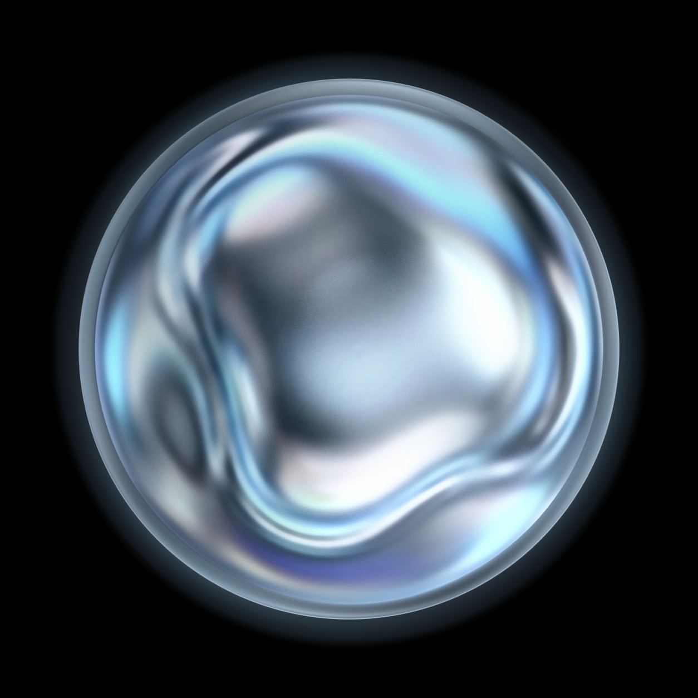
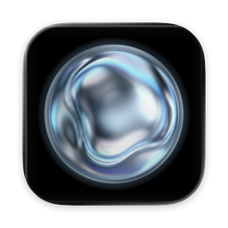
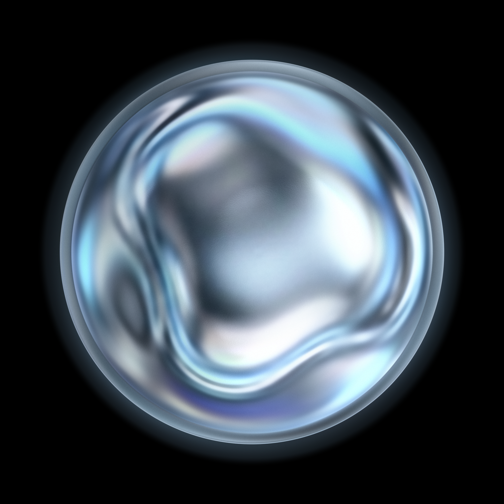

# Orb — Procedural WebGL2 Liquid-Chrome Shader

<p align="center">
  
</p>

Real-time **60 FPS** and native **4K** procedural WebGL2 shader that synthesizes and animates the **Orb** liquid-mercury sphere on a pure `#000000` background—with **zero bitmap textures** in the rendering pipeline.

---

## Preview

| WebGL2 Shader Master (`1254 × 1254`) | macOS Squircle (`Orb.icon` / `.icns`) | iOS AppIcon (`1024 × 1024`) |
| :---: | :---: | :---: |
|  |  |  |

---

## Approach & 4-Pass GPU Architecture

Instead of warping a low-resolution bitmap image, the orb is decomposed into compact **Fourier-Chebyshev spectral harmonic matrices** (`orb_assets.js`) and synthesized directly on the GPU in four WebGL2 shader passes (`index.html`):

1. **Pass 1 (`fsSynthAng` & `fsSynthRad`) — $C^\infty$ Spectral Harmonic Synthesis**:
   - Evaluates $K = 60$ radial Cosine-Chebyshev modes $\times$ $M = 60$ angular Fourier modes into a `2048 × 2048` `RGBA16F` floating-point framebuffer, enforcing $C^\infty$ regularity at the polar origin ($s \to 0$).
2. **Pass 2 (`fsShock`) — Osher-Rudin Shock-Wave Super-Resolution**:
   - Applies 2D isotropic shock-wave ridge steepening ($\mathbf{u} \leftarrow \mathbf{u} - w\,\tanh(\Delta L)\,\nabla L / \|\nabla L\|$) to sharpen internal liquid-mercury fold creases without pixelation or ringing.
3. **Pass 3 (`fsNorm`) — Analytical 32-Bit Surface Normals & Dispersion Mask**:
   - Extracts smooth 3D surface normals $(n_x, n_y, n_z)$ and a thin-film iridescence mask from the spectral heightfield potential.
4. **Pass 4 (`fsRender`) — Real-Time 60 FPS / 4K Liquid-Chrome BRDF & Analytical Shell**:
   - **Incompressible Curl-Streamfunction Flow ($\psi$)**: 2nd-order Runge-Kutta advection of the liquid-mercury core using a 24-second multi-regime harmonic streamfunction ($L^6$ boundary pinning at $r = 0.934$).
   - **Per-Pixel 4K Analytical Geometry**: Evaluates the outer circular silhouette ($r = 0.9985$) with 1-pixel hardware `fwidth(r)` anti-aliasing, the specular chrome rim wire ($r = 0.9960$), the glass containment shell bezel ($0.9385 \le r \le 0.9985$), and the double-exponential atmospheric halo ($r > 0.9985$) analytically per pixel in `highp float` GLSL.
   - **Metallic Chrome BRDF & Anodized Micro-Grain**: Combines an S-curve platinum contrast curve, Schlick grazing Fresnel sheen, thin-film cyan/cobalt/violet dispersion, filmic highlight headroom rolloff (`headroom * tanh(boost / headroom)`), and multi-scale advected crystalline micro-facets + spatial blue-noise silver grain.

---

## Usage

### 1. Live 60 FPS Interactive Shader
Serve the directory and open `index.html`:
```bash
python3 -m http.server 8765
open http://localhost:8765/index.html
```
- Press **`H`** or append `?clean=1` to hide the studio HUD.
- Press **`4`** (or click **Export 4K PNG**) to download a native `3840 × 4126` 4K PNG directly from the browser.

### 2. Headless GPU Export (4K + macOS & iOS App Icons)
`index.html` accepts URL query parameters (`?clean=1&res=4k&t=0.35` or `?clean=1&w=1254&h=1254&r=0.388&t=0.35`) for deterministic headless rendering on Apple Metal:
```bash
python3 scripts/export_icons.py
```

---

## Repository Structure

- `index.html` — Self-contained 4-pass WebGL2 GLSL shader, interactive studio HUD, and 4K/WebM exporter.
- `orb_assets.js` — Compact Fourier-Chebyshev spectral harmonic coefficients (zero bitmap images).
- `orb_4k.png` / `orb.png` — Native `3840 × 4126` 4K and `1254 × 1254` shader-rendered masters.
- `icons/macos/` — macOS Icon Composer bundle (`Orb.icon`), compiled `icon.icns`, and squircle PNGs.
- `icons/ios/AppIcon.appiconset/` — Complete iOS `AppIcon.appiconset` (`icon-1024.png` down to `icon-20.png`).
- `scripts/extract_spectral_harmonics.py` — Decomposes `reference.png` into `orb_assets.js`.
- `scripts/export_icons.py` — Renders `orb_4k.png`, `orb.png`, and macOS/iOS icons via headless Chrome + Metal.
